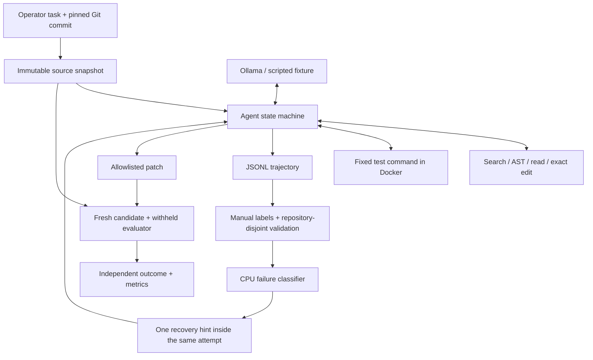

# Aurora

**An evaluation-driven coding agent that turns failures into controlled experiments.**

Aurora investigates a local Git task, edits permitted source files, runs tests, and records its actions. A separate harness applies its patch to a fresh snapshot and checks acceptance and regression tests. A CPU-trained failure classifier can suggest one recovery action during the same attempt.

The research question: **Does a learned failure intervention improve coding-task resolution under the same inference budget?**

## Current status

This is the first working foundation, not a completed benchmark study. The agent runtime, local Ollama adapter, Docker runner, independent local-task grader, trace collection, metrics, manual annotation export, and supervised classifier pipeline are implemented. The bundled demo uses a **scripted policy with a known patch**, not an LLM. Unit-test training examples are synthetic. No real-world resolution rate, learned improvement, GPU training result, or SWE-bench score is claimed.

Aurora currently has no web dashboard, GitHub issue importer, official SWE-bench integration, embedding model, PyTorch training, LoRA adapter, or MLflow integration. Those are later milestones. The first useful ML baseline is multinomial Naive Bayes; it runs without a GPU or third-party Python packages.

## Start on this Windows computer

Open PowerShell:

```powershell
cd "$env:USERPROFILE\Downloads\Aurora"
.\aurora.ps1 demo
```

The launcher uses a project virtual environment if present, then the bundled Python available with Codex, then a normal Python installation. If script execution is restricted, run this single script in a separate process:

```powershell
powershell -NoProfile -ExecutionPolicy Bypass -File .\aurora.ps1 demo
```

This changes no persistent execution-policy setting. The demo copies Aurora's own trusted fixture, initializes that copy as a Git repository, runs the scripted agent, and saves results under `.aurora/demo`. It executes that fixture on the host. It does not change the example source or another repository. Expected outcome: `resolved`, `synthetic: true`, and five tool calls.

With a normal Python 3.11+ installation, these commands work on Windows, macOS, and Linux from the repository root:

```sh
python -m aurora demo
python -m unittest discover -s tests -v
```

There are no runtime dependencies to install. Optional editable installation: `python -m pip install -e .`. Run demos from this source checkout; a standalone wheel does not package the example repository.

## Make a real model attempt

Use a coding-capable model already installed in Ollama. CPU performance depends on model size and available RAM; begin with a small quantized model that fits your machine. There is no automatic model download, paid API, or cloud GPU requirement. See the [Ollama chat API](https://docs.ollama.com/api/chat) for the provider contract.

Prepare a fresh task and copy the printed path:

```powershell
.\aurora.ps1 prepare-demo
ollama list
# Start Docker Desktop and pull this image once, if it is not present:
docker pull python:3.12-slim
.\aurora.ps1 run '<printed task.json path>' --model '<exact installed model name>'
```

The `run` command defaults to Docker. For **only the bundled trusted fixture**, it can also run on the host:

```powershell
.\aurora.ps1 run '<printed task.json path>' --model '<installed model>' --backend local --allow-local --wall-seconds 600
```

`--allow-local` permits actual code execution on this computer. Use Docker for other repositories. Aurora never silently falls back from Docker to local execution. At initial verification, Docker's engine was stopped and no usable Ollama server/model was available, so live inference and Docker execution were not verified here.

To add a task, copy `examples/nested-config/task.template.json`, point it at an existing local Git repository, pin `base_commit` to a commit SHA, enumerate editable source files, and supply operator-owned evaluator tests in a directory outside the repository. Commands are argv arrays, not shell strings. The agent cannot alter them. `expected_failure` must be a distinctive substring from the known baseline failure. Inspect that failure manually before trusting a task. This small harness is for curated Python tasks; it is **not** the official SWE-bench scorer.

## What a run records

```text
run/
  metadata.json       # exact Git commit, source/evaluator hashes, budgets, runtime
  trace.jsonl         # model replies, requested tools, observations, timestamps
  patch.diff          # human-readable source patch
  patch.json          # replayable changes with SHA-256 preimages
  summary.json        # baseline, independent grading, tokens, latency, outcome
  baseline/           # untouched Git snapshot
  workspace/          # agent-visible repository; no evaluator tests
  evaluator/          # frozen operator tests; not exposed to model tools
  baseline-grade/     # acceptance tests on the original source
  candidate-grade/    # source patch applied to a fresh baseline + evaluator
```

An attempt is resolved only if its baseline fails with exit code 1 and the expected failure marker, and both independent acceptance and public regression tests pass on the candidate. A model's `finish` message is not a success signal. Setup failures, timeouts and invalid baselines have separate outcomes. Process failures can still be ambiguous; task authors must review evaluator behavior. A malicious candidate can manipulate in-process Python tests, so this is not an adversarially secure grading system.

The runtime has step, reported-token, response-size, context-size, and time limits. Tokens are checked after each response; the final request can overshoot the total-token limit, and no tool from that response is executed. The wall limit governs the agent loop, not repository preparation or independent grading. OS, network and cleanup overhead can extend wall time. Ollama temperature and seed are recorded; that does not guarantee bit-for-bit inference reproducibility. Record the local model digest before a formal study.

## Train the CPU failure classifier

1. Collect attempts on **training and validation tasks**, keeping final test tasks sealed.
2. Export each trace's first observable failure prefix:

```powershell
.\aurora.ps1 annotation '<run directory>' --repository-group owner/repo --split train --output data/failures.jsonl
```

3. Manually replace each `label: null` with one of `retrieval`, `edit`, `test_failure`, `environment`, `timeout`, `budget`, or `protocol`. See [the annotation guide](docs/ANNOTATION.md). Collect validation rows from different repositories with `--split validation`.
4. Train and compare against majority-class and heuristic baselines:

```powershell
.\aurora.ps1 train-failures data/failures.jsonl --output models/failure-nb.json
```

The command checks disjoint task IDs and repository groups, rejects identical text across partitions, and writes accuracy, macro-F1, and a confusion matrix. These guards do not detect near-duplicate patches, aliases or pretrained-model contamination. Manual curation remains necessary.

5. Test the learned intervention with the same tasks and budgets as the baseline:

```powershell
.\aurora.ps1 run '<task.json>' --model '<installed model>' --failure-model models/failure-nb.json --output .aurora/intervention
```

At the first tool/action failure, the classifier sees only observations available at that point and adds one category-specific suggestion. It does not get independent grader output or start a second attempt. The hint's later prompt tokens count toward the same budget. The annotation exporter uses that same prefix. Classifier accuracy alone is not evidence of improved agent resolution. See [the experiment protocol](docs/EXPERIMENTS.md).

## Report experiments

```powershell
.\aurora.ps1 report '<one configuration directory>' --output .aurora/report.json
.\aurora.ps1 compare '<baseline directory>' '<intervention directory>'
```

Reports include pass@1, a 95% Wilson interval, median/p95 end-to-end latency, reported tokens, tool calls, and outcomes. Keep one attempt per task; the reporter rejects duplicate tasks and mixed configurations. Record all planned tasks, including provider failures. Aborted runs with `error.json` require an explicit accounting decision before a study is reported. Unknown inference cost stays `null`, not zero. No energy-cost estimate is made for local inference.

Paired comparisons require the same task fingerprints, runtime, and budgets. They show resolution difference and an exact McNemar test. Scripted runs cannot be used in paired model comparisons. Latency includes preparation and grading; do not label it model latency.

## Architecture



Read [the code walkthrough](docs/WALKTHROUGH.md), [execution design](docs/EXECUTION.md), and [CPU-first roadmap](docs/ROADMAP.md) before extending the system.

## Portfolio claims

Accurate descriptions of this implementation:

- Built a Python coding-agent runtime with constrained file tools, structured trajectories, and independent patch evaluation.
- Implemented a CPU failure-classification pipeline with repository-disjoint validation and paired agent comparisons.

Add a measured results bullet only after a real held-out study. Do not list PyTorch, LoRA, SWE-bench performance, or a percentage improvement until those components or results exist.
